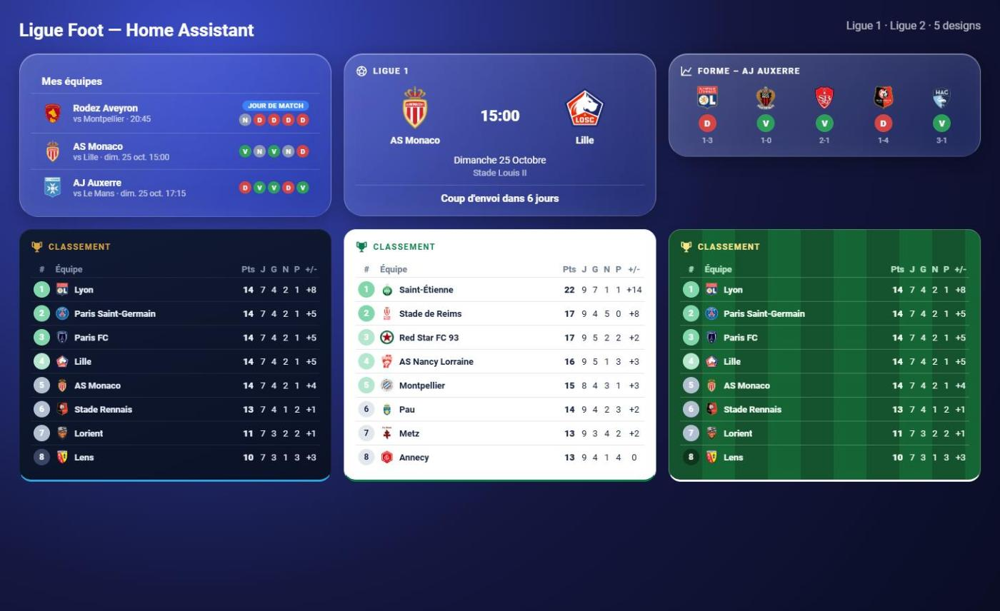

# ⚽ Ligue Foot pour Home Assistant

Intégration Home Assistant pour suivre le football européen (**Ligue 1**, **Ligue 2**, Premier League, LaLiga, Bundesliga, Serie A, Liga Portugal, Jupiler Pro League) : classement, résultats, prochains matchs, rappels de match, et des cartes Lovelace prêtes à l'emploi — **sans aucune dépendance** (pas de card-mod, mushroom ou button-card).



## Ce qu'elle propose

- **8 championnats** : Ligue 1, Ligue 2, Premier League (Angleterre), LaLiga (Espagne), Bundesliga (Allemagne), Serie A (Italie), Liga Portugal et Jupiler Pro League (Belgique). Tu en choisis un ou plusieurs.
- **Plusieurs équipes favorites** : chacun choisit les siennes dans l'interface, sans YAML.
- **Rappels de match intégrés** : une notification avant le coup d'envoi (délai et message personnalisables).
- **Interface en français** (et en anglais).
- **Capteurs** par équipe : prochain match, dernier résultat (forme sur 5 matchs), et **jour de match** (capteur binaire).
- **Capteurs** par championnat : classement complet, journée en cours et prochaine journée.
- **Capteur global** « Jour de match (favoris) » : allumé dès qu'une de tes équipes joue aujourd'hui, pratique pour tes automatisations.
- **Lumières connectées** : tes ampoules **Philips Hue** et ton **Ambilight** prennent les couleurs de ton équipe (voir plus bas).
- **5 cartes Lovelace** livrées avec l'intégration, installées automatiquement.

Données fournies par l'API publique non officielle d'ESPN, mise à jour toutes les 15 minutes.

## Les cartes

| Carte | Type | Entité |
|---|---|---|
| Mes équipes | `custom:ligue-foot-teams-card` | aucune (détection automatique) |
| Prochain match | `custom:ligue-foot-next-match-card` | capteur « Prochain match » |
| Forme de l'équipe | `custom:ligue-foot-form-card` | capteur « Dernier résultat » |
| Classement | `custom:ligue-foot-standings-card` | capteur « Classement » |
| Journée | `custom:ligue-foot-matchday-card` | capteur « Journée » |

### 5 designs au choix (option `design`, par carte)

| Valeur | Style |
|---|---|
| `night` | Nuit (défaut), bleu foncé et or |
| `ha` | Natif Home Assistant, suit ton thème |
| `light` | Clair |
| `stadium` | Pelouse de stade |
| `glass` | Verre liquide, translucide avec flou d'arrière-plan |

Les cartes s'adaptent à leur largeur (colonnes masquées sur les petits écrans).

## Installation

### Via HACS (recommandé)

1. HACS → menu ⋮ → **Dépôts personnalisés**.
2. Ajoute `https://github.com/skyrotter/ligue_foot`, catégorie **Intégration**.
3. Cherche **Ligue Foot** dans HACS, puis **Télécharger**.
4. **Redémarre Home Assistant.**
5. **Paramètres → Appareils et services → Ajouter une intégration → Ligue Foot.**
6. Choisis ton ou tes championnats, puis tes équipes favorites.

### Manuelle

Copie le dossier `custom_components/ligue_foot` dans le dossier `custom_components` de ta configuration, puis redémarre.

## Installer les cartes

Rien à faire : les cartes sont chargées automatiquement avec l'intégration (pas de ressource à ajouter à la main).

1. Sur ton tableau de bord, passe en mode édition, puis **Ajouter une carte**.
2. Cherche **Ligue Foot** (ou « Mes équipes », « Classement »…).
3. Choisis l'entité et le design dans l'éditeur visuel.

Si les cartes n'apparaissent pas, fais un rechargement forcé du navigateur (Ctrl+Maj+R).

### Exemples YAML

```yaml
type: custom:ligue-foot-teams-card
design: glass
```

```yaml
type: custom:ligue-foot-standings-card
entity: sensor.ligue_1_classement
design: night
max_rows: 10
highlight: AS Monaco   # une ou plusieurs équipes, séparées par une virgule
```

```yaml
type: custom:ligue-foot-next-match-card
entity: sensor.as_monaco_prochain_match
design: stadium
```

## Lumières : Philips Hue et Ambilight

Les lampes prennent les couleurs de ton équipe pendant le match. Ça marche avec **toute entité light** de Home Assistant : ampoules et bandeaux Philips Hue, Ambilight de ta TV Philips (intégration Philips TV), et toute autre lampe compatible.

**Paramètres → Appareils et services → Ligue Foot → Configurer**, puis choisis tes lampes et les effets :

| Option | Effet |
|---|---|
| Lampes | Les entités `light` à piloter (Hue, Ambilight, ...) |
| Couleurs de l'équipe au coup d'envoi | Les lampes passent aux couleurs de ton équipe quand le match commence |
| Flash quand ton équipe marque | Clignotement aux couleurs de l'équipe à chaque but |
| Ambiance avant le match | Les lampes s'allument aux couleurs de l'équipe X minutes avant (0 = désactivé) |
| Rétablir les lampes | Les lampes reviennent à leur état d'avant à la fin du match |

Pendant un match, les données sont rafraîchies toutes les minutes, donc le flash de but peut avoir une à deux minutes de retard. Les couleurs viennent d'ESPN.

## Rappels de match

**Paramètres → Appareils et services → Ligue Foot → Configurer** : choisis un service `notify.*`, le délai avant le coup d'envoi et le texte du message.

Variables : `{home}`, `{away}`, `{time}`, `{minutes}`, `{venue}`, `{league}`.

Exemple d'automatisation avec le capteur « jour de match » :

```yaml
trigger:
  - platform: state
    entity_id: binary_sensor.ligue_foot_jour_de_match_favoris
    to: "on"
action:
  - service: light.turn_on
    target:
      entity_id: light.salon
```

## Limites connues

- Données issues d'une API ESPN non officielle : elle peut changer sans préavis.
- Pour changer d'équipes favorites, supprime puis recrée l'intégration.
- Les couleurs de l'équipe sont celles fournies par ESPN, et le retard d'un but peut aller jusqu'à environ deux minutes.
- Championnats nationaux uniquement (pas de coupes ni de compétitions européennes pour l'instant).

## Liens

- Dépôt : https://github.com/skyrotter/ligue_foot
- Bugs et idées : https://github.com/skyrotter/ligue_foot/issues
